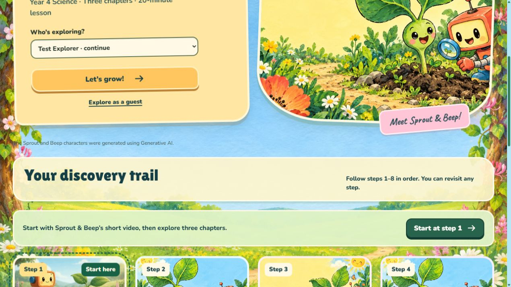
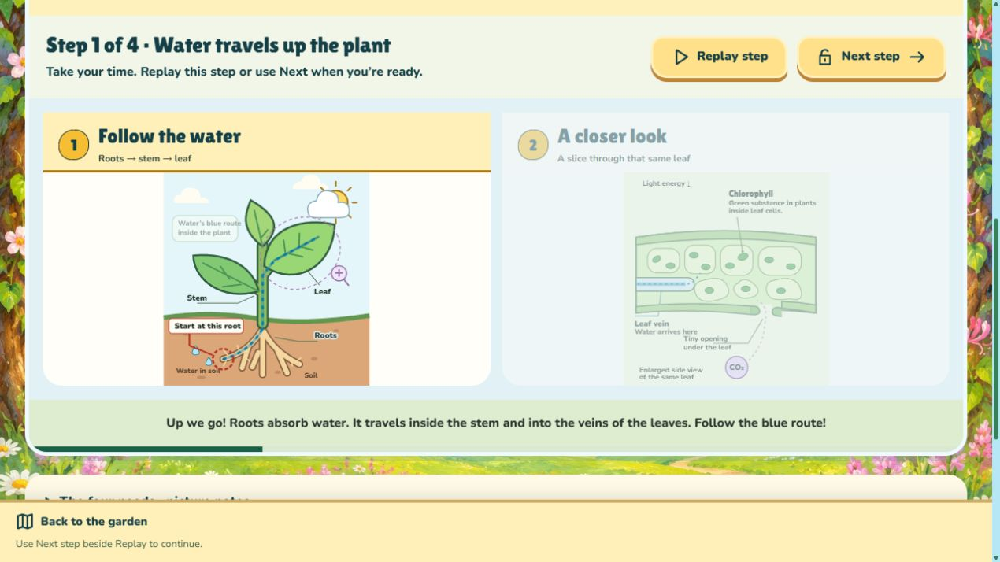
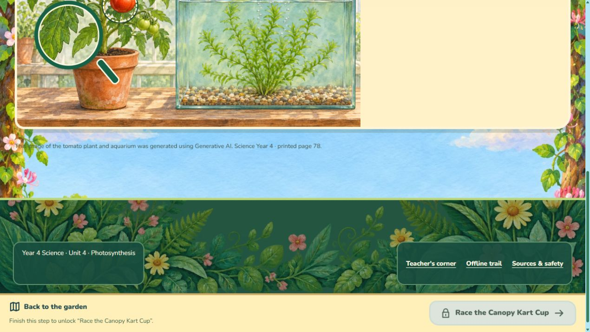
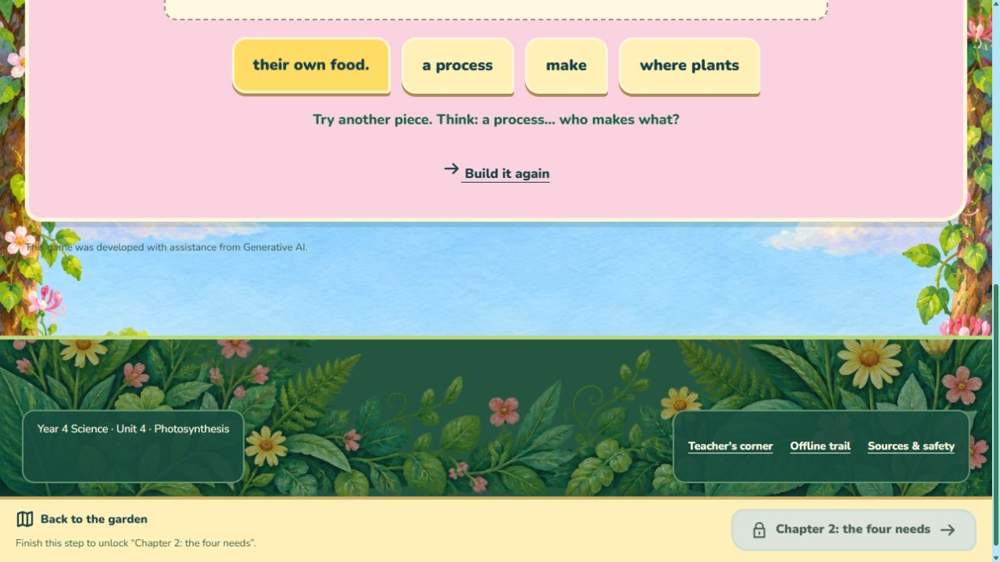
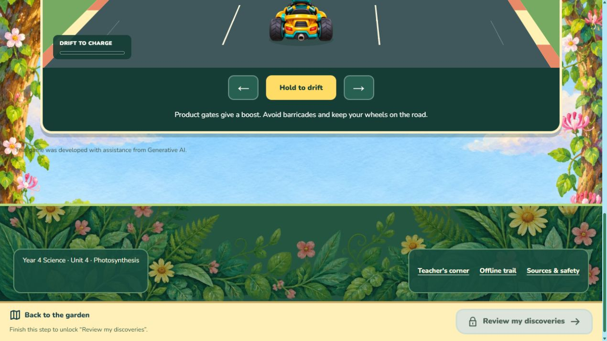
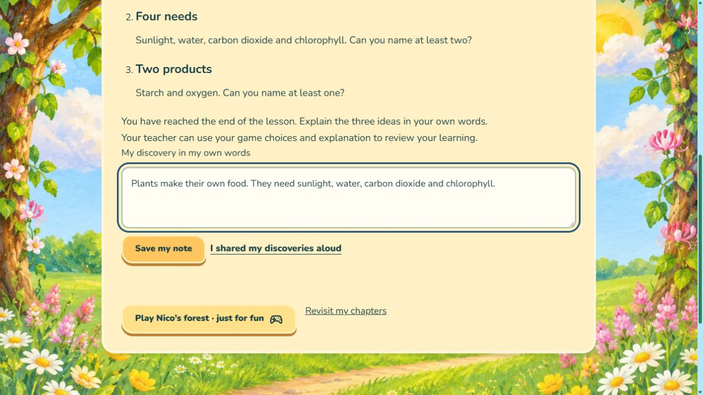
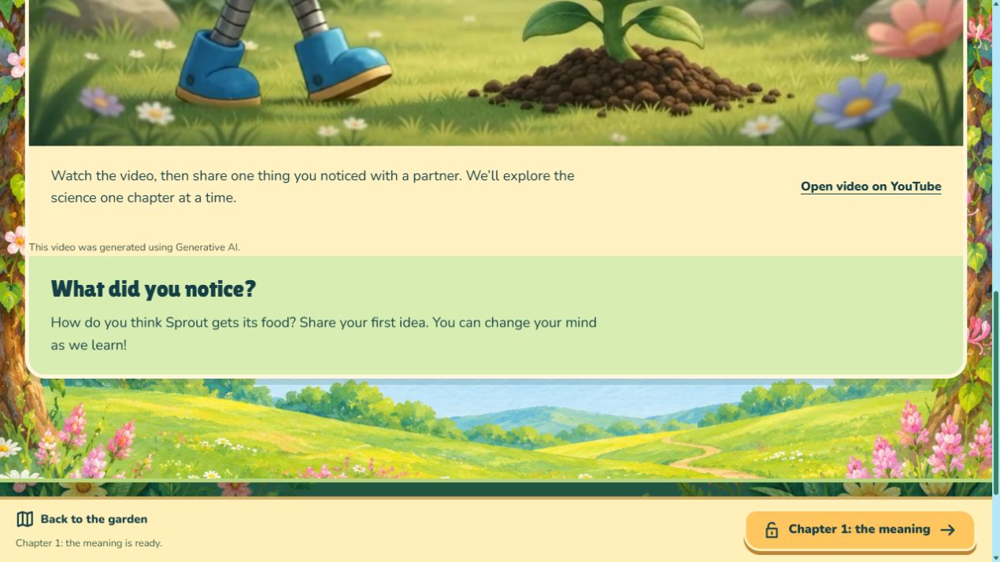

# Dokumentasi produk Sprout Lab

Sprout Lab ialah bahan pembelajaran dalam talian bagi topik fotosintesis Sains Tahun 4. Produk ini menggabungkan video, gambar rajah, animasi dan permainan untuk membantu murid memahami maksud fotosintesis, keperluan tumbuhan serta hasil proses tersebut. Masa yang diperuntukkan ialah 20 minit. Kandungan murid disampaikan dalam bahasa Inggeris, sesuai dengan buku teks Science Year 4 yang digunakan.

Sasaran ialah murid berumur sekitar sepuluh tahun yang sudah mengenali bahagian asas tumbuhan. Persoalan awalnya ialah bagaimana tumbuhan memperoleh makanan. Murid mengikuti lapan hentian, bermula dengan video Sprout dan Beep dan berakhir dengan jurnal. Hutan Nico disediakan sebagai permainan tambahan selepas pelajaran.

## Hasil pembelajaran

Selepas menggunakan produk, murid dapat menyatakan maksud fotosintesis dengan betul, menyenaraikan sekurang-kurangnya dua keperluannya dan mengenal pasti sekurang-kurangnya satu hasil melalui pemerhatian media. Hasil ini dipadankan dengan standard 4.2.1, 4.2.2 dan 4.2.3 dalam DSKP Sains Tahun 4. Guru menilai jawapan permainan bersama penjelasan lisan atau tulisan murid.

<!-- page -->

# Reka bentuk pengajaran dan penguasaan guru

Gagné digunakan untuk menyusun pengalaman daripada perhatian awal hingga pengukuhan (Gagné et al., 2005). TPACK pula menghubungkan pengetahuan kandungan, kaedah mengajar dan teknologi (Mishra & Koehler, 2006).

| Bahagian pelajaran | Masa | Peranan pengajaran |
| --- | --- | --- |
| Video dan soalan awal | 2 minit | Menarik perhatian dan mengingat pengetahuan sedia ada |
| Maksud dan permainan ayat | 3 minit | Menyatakan sasaran, menerangkan konsep dan mencungkil respons |
| Model daun dan Collect & Avoid | 6 minit | Memberi bimbingan, latihan dan maklum balas |
| Rumah hijau dan Kart Cup | 7 minit | Memerhati hasil, membezakan pilihan dan mencuba semula |
| Jurnal dan rumusan | 2 minit | Mengingat semula dan menerangkan idea dengan kata sendiri |

Dalam TPACK, kandungannya ialah fotosintesis. Kaedah mengajar melibatkan pemerhatian berpandu, latihan berulang dan pentaksiran formatif. Teknologi dipilih mengikut fungsi: animasi menjejaki proses, permainan mendapatkan respons dan jurnal menyimpan penjelasan. Sebagai contoh, model daun membantu murid melihat laluan air yang sukar diperhatikan secara langsung.

## Domain PdP dan Etika AI

Mengikut penjelasan pensyarah yang disampaikan dalam pelaksanaan tugasan, dua domain ini ditunjukkan melalui penguasaan guru semasa membangunkan bahan. Dalam domain PdP, guru menggunakan bantuan AI untuk menyediakan kod, ilustrasi, penerangan dan aktiviti, kemudian menyesuaikannya dengan hasil pembelajaran. Pemilihan media dan ketepatan sains tetap menjadi tanggungjawab guru.

Dalam domain Etika AI, guru mengisytiharkan bantuan yang digunakan, menyemak fakta, merekod sumber aset dan menjaga data pengguna. Hasil AI dinilai sebelum diterima. Oleh itu, aktiviti AI detective telah dibuang dan murid tidak diwajibkan menggunakan alat AI atau akaun AI.

<!-- page -->

# Kandungan dan pemerhatian melalui media

Bab pertama memperkenalkan fotosintesis sebagai proses tumbuhan membuat makanan sendiri. Bab kedua menerangkan air, karbon dioksida, cahaya matahari dan klorofil melalui empat langkah. Murid boleh memainkan semula langkah sebelum meneruskan.

Bab ketiga menggunakan rumah hijau bergambar. Murid meneliti buah dengan kanta pembesar dan meletakkan tiub pada laluan gelembung tumbuhan akuatik. Penerangan menghubungkan glukosa, penyimpanan sebagai kanji dan pelepasan oksigen, berpandukan Science Year 4, halaman 76–78.

Aktiviti ini ialah model pengajaran, bukannya eksperimen sebenar. Melihat buah sahaja tidak membuktikan kehadiran kanji; hubungan itu diterangkan berdasarkan rujukan. Begitu juga, simbol klorofil dalam permainan mewakili bahan yang sudah berada dalam tumbuhan.

<!-- page -->

# Pentaksiran melalui permainan

Tiga permainan digunakan sebagai e-pentaksiran formatif. Dalam Build the Meaning, murid memilih cebisan ayat mengikut urutan. Pilihan yang salah menghasilkan petunjuk dan murid boleh membetulkannya. Collect & Avoid menilai pengecaman empat keperluan melalui simbol. Pilihan calm mode menyediakan tugas memilih tanpa objek bergerak.

Canopy Kart Cup meminta murid memilih kanji atau oksigen antara pilihan yang turut mengandungi keperluan fotosintesis. Pilihan produk memberi tambahan kelajuan, manakala pilihan keperluan disertai penjelasan dan pengurangan kelajuan. Murid boleh bermain semula untuk membaiki keputusan.

Guru menggunakan pola pilihan, pembetulan dan penjelasan murid sebagai bukti. Kedudukan perlumbaan dan tanda selesai sahaja tidak menetapkan Tahap Penguasaan rasmi. Selepas permainan, murid merumuskan maksud, dua keperluan dan satu hasil tanpa bergantung pada nota.

<!-- page -->

# Prinsip multimedia dan akses pengguna

Prinsip multimedia digunakan untuk mengurangkan maklumat yang bersaing. Penerangan dipecahkan kepada langkah kecil, petunjuk diletakkan berhampiran bahagian rajah dan teks membantu pengguna yang tidak mendengar audio. Ini selaras dengan penggunaan kata dan grafik untuk menyokong pembelajaran (Mayer, 2020).

| Prinsip CASPER | Contoh dalam produk |
| --- | --- |
| Contrast | Teks gelap pada latar cerah dan keadaan butang dibezakan |
| Alignment | Tajuk, arahan dan ruang aktiviti disusun mengikut tepi kandungan |
| Simplicity | Satu fokus sains pada setiap langkah penerangan |
| Proximity | Label, kawalan dan maklum balas berada dekat dengan aktiviti |
| Emphasis | Bahagian aktif serta butang untuk meneruskan diberi penekanan |
| Repetition | Bentuk butang dan cara kembali ke halaman utama diulang |

Tulisan lebih besar, pengurangan pergerakan, kawalan papan kekunci dan calm mode membantu pengguna yang mempunyai keperluan berbeza. Bahan Offline trail menyediakan alternatif bercetak apabila capaian internet terhad. Video memerlukan sambungan internet; teks dan aktiviti bercetak menyokong penerangan guru apabila video tidak dapat dibuka.

Murid boleh menulis satu penemuan atau berkongsi secara lisan. Kemajuan dan catatan disimpan dalam browser peranti. Guru boleh menggunakan perbincangan berpasangan dan bacaan bersama untuk menyokong murid yang memerlukan bantuan bahasa.

<!-- page -->

# Penggunaan AI dan sumber aset

Generative AI membantu pembangunan permainan serta penghasilan sebahagian gambar dan video. Media yang terlibat termasuk gambar tumbuhan tomato bersama akuarium, watak Sprout dan Beep serta video pengenalan. Nota ringkas diletakkan pada bahagian berkenaan dalam website. Nota video ialah “This video was generated using Generative AI”.

 Nota watak dinyatakan sekali pada halaman utama.

Log ringkas menyenaraikan bahan dan tujuan penggunaannya. Contoh prompt dibina semula untuk menerangkan arahan penghasilan bahan; contoh tersebut tidak dianggap salinan prompt asal. Bantuan AI dalam kod dan penyediaan draf bahan sokongan turut diisytiharkan. Guru bertanggungjawab menyemak fakta dan kesesuaian bahan sebelum digunakan.

| Bahan | Tujuan penggunaan AI |
| --- | --- |
| Permainan | Membantu menyediakan mekanik, pilihan jawapan dan maklum balas |
| Gambar tomato dan akuarium | Menyediakan latar aktiviti pemerhatian hasil fotosintesis |
| Sprout dan Beep | Menghasilkan watak yang menemani penerangan dan aktiviti |
| Video pengenalan | Memperkenalkan persoalan bagaimana tumbuhan memperoleh makanan |

Nico menggunakan watak Timmy daripada Adobe Mixamo. Sumber ini tidak dilabel CC0. Aset alam pula menggunakan Quaternius Stylized Nature MegaKit Standard di bawah CC0. Three.js mengekalkan lesen MIT dan jenis huruf mengekalkan SIL Open Font License. Model pihak lain tidak didakwa sebagai hasil ciptaan pembangun.

Pengguna tidak perlu membuka akaun murid. Kemajuan serta jurnal disimpan dalam browser peranti. Guru mengingatkan murid agar tidak menulis maklumat peribadi dalam jurnal. Kandungan sains disemak menggunakan buku teks dan DSKP Sains Tahun 4.

<!-- page -->

# Analisis data simulasi dua responden

Data ini ialah simulasi dan bukan respons Google Form sebenar atau bukti dua penguji dewasa. Purata A ialah 4.43, purata B ialah 4.57 dan purata keseluruhan ialah 4.50 daripada 5. Skor A: 5, 4, 4, 5, 4, 5, 4. Skor B: 4, 5, 5, 4, 4, 5, 5.

Cadangan simulasi ialah menyediakan contoh cara bermain dan petunjuk kedudukan tiub gas. Tindakan ini belum dianggap penambahbaikan yang diuji. Ujian sebenar masih perlu dilaksanakan.

<!-- page -->

## Rujukan

Adobe. (n.d.). <i>Mixamo common questions</i>. https://helpx.adobe.com/creative-cloud/faq/mixamo-faq.html

Gagné, R. M., Wager, W. W., Golas, K. C., & Keller, J. M. (2005). <i>Principles of instructional design</i> (5th ed.). Thomson/Wadsworth.

Institut Pendidikan Guru Kampus Kent. (2026). <i>Tugasan pentaksiran berterusan EDUP3133 Ogos 2026 hingga Disember 2026</i>.

Kementerian Pendidikan Malaysia. (2018). <i>Kurikulum standard sekolah rendah Sains Tahun 4 Edisi Bahasa Inggeris Dokumen standard kurikulum dan pentaksiran</i>.

Kementerian Pendidikan Malaysia. (n.d.). <i>Science Year 4</i> [Petikan Unit 4, halaman 69–82].

Kementerian Pendidikan Malaysia. (2026). <i>Panduan literasi kecerdasan buatan AI</i>. https://www.moe.gov.my/pekeliling

Mayer, R. E. (2020). <i>Multimedia learning</i> (3rd ed.). Cambridge University Press. https://doi.org/10.1017/9781316941355

Mishra, P., & Koehler, M. J. (2006). Technological pedagogical content knowledge: A framework for teacher knowledge. <i>Teachers College Record, 108</i>(6), 1017–1054. https://doi.org/10.1111/j.1467-9620.2006.00684.x

Quaternius. (2024). <i>Stylized Nature MegaKit</i>. https://quaternius.com/packs/stylizednaturemegakit.html
